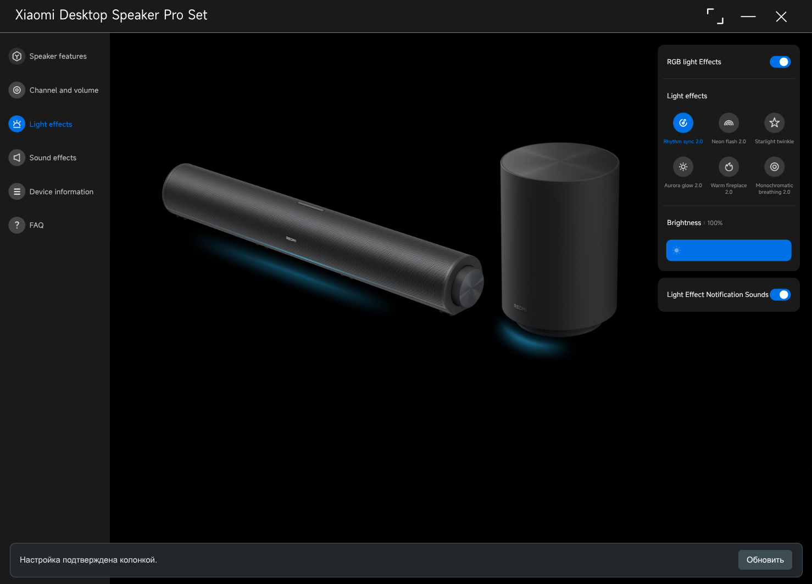

# Xiaomi C-HUB для Linux

Управление **Xiaomi Desktop Speaker Pro Set** через оригинальный интерфейс
C-HUB: подсветка, эквалайзер, режимы звука, громкость и выбор входа.

[English](README.md) · [Подробная установка](docs/INSTALL.md)

## Скачать

- [**AppImage для Linux x86-64**](https://github.com/up4k73/xiaomi-c-hub-linux/releases/latest/download/Xiaomi-C-HUB-Linux-x86_64.AppImage) — скачайте и запустите. Если файловый менеджер попросит, разрешите выполнение файла.
- [**Установщик для Debian / Ubuntu**](https://github.com/up4k73/xiaomi-c-hub-linux/releases/latest/download/xiaomi-c-hub-linux_amd64.deb) — откройте в установщике программ, затем запустите Xiaomi C-HUB for Linux из меню.
- [Архив переносимой версии](https://github.com/up4k73/xiaomi-c-hub-linux/releases/latest/download/xiaomi-c-hub-linux-x86_64.tar.gz) — распакуйте и запустите файл xiaomi-c-hub-linux.

**Node.js, npm, Windows и ручное извлечение файлов Xiaomi не нужны.**

При первом запуске приложение само получает около **40 МБ** файлов оригинального
интерфейса с серверов Microsoft, проверяет их и открывает окно C-HUB.
Для этой однократной подготовки нужен интернет. Затем интерфейс хранится
локально и работает без повторной загрузки.

Подключите колонку USB-кабелем. Установщик .deb настраивает доступ к устройству.
В переносимой версии при необходимости появится кнопка **Enable USB access**:
она запросит системное подтверждение и настроит доступ только для этой модели.

## Возможности

В **Подсветке** доступны шесть эффектов, десять уровней яркости и переключатель
озвучки. **Свеча** включает «Камин 2.0» на 20% яркости и отключает озвучку
эффектов. Анимация снизу вверх показывается в окне. Колонка воспроизводит
штатный эффект, для которого управление направлением по USB не подтверждено.

В отдельном пункте **Микрофон** доступны аппаратный уровень и выключатель,
аналоговая чувствительность, эхоподавление и подавление тихого сигнала.
Расширенные параметры записи открываются там же, параметры DSP воспроизведения —
в **Звуке**, вместе с обычными режимами и эквалайзером. Уровень USB и выключатель
используют `amixer` из `alsa-utils`. Установщик .deb добавляет эту зависимость.

Кнопка **Обновить** перечитывает состояние после подключения колонки или
использования её физических кнопок. Обновление прошивки, сброс и перезапуск
устройства не входят в список поддерживаемых операций.

На Debian 13 / KDE X11 с B03 V50 (2717:d007) проверены все шесть режимов,
яркость и «Свеча». Отдельный выбор пяти оттенков «Дыхания» на этой прошивке
не подтверждён. [Результаты проверки](docs/VALIDATION.md).

## Для разработчиков

~~~bash
git clone https://github.com/up4k73/xiaomi-c-hub-linux.git
cd xiaomi-c-hub-linux
npm ci
npm test
npm run package
~~~

Готовые пакеты появляются в **dist/**. Версии, источники и контрольные суммы
указаны в [описании сборки](docs/SOURCES.md).

Независимый проект. Код адаптера — MIT; права на оригинальный интерфейс Xiaomi
сохраняются за его владельцами.
