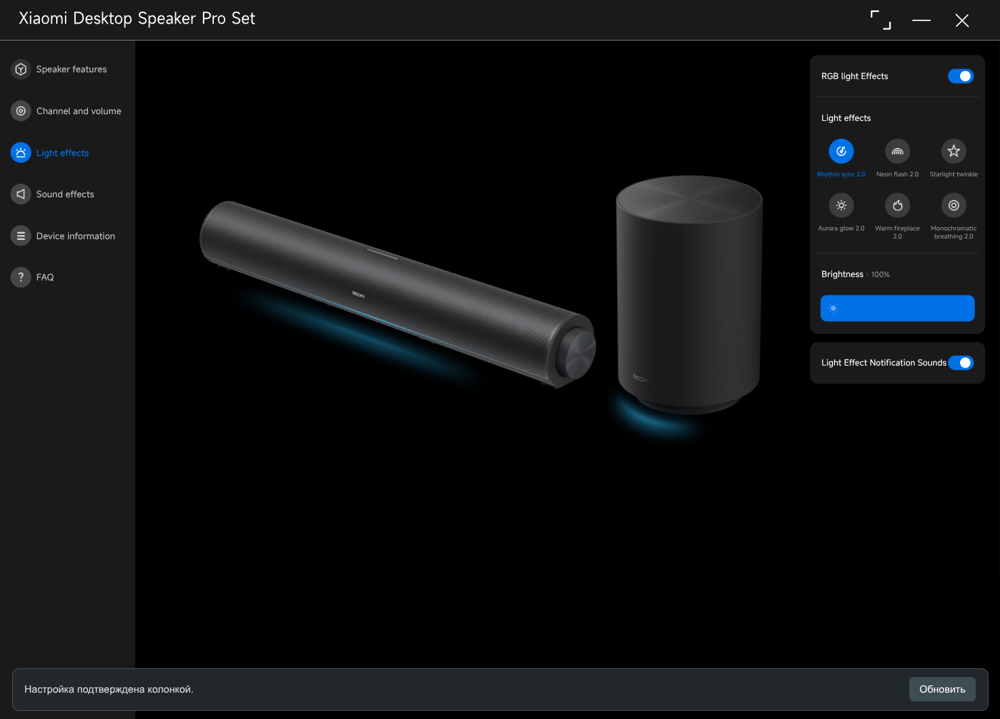

# Xiaomi C-HUB для Linux

Управление **Xiaomi Desktop Speaker Pro Set** через оригинальный интерфейс
C-HUB: подсветка, эквалайзер, звуковые режимы, громкость и выбор входа.

[English](README.md) · [Подробная установка](docs/INSTALL.md) · [Решение проблем](docs/TROUBLESHOOTING.md)



Приложение работает в Linux через Electron. USB-обмен выполняет этот адаптер.
Это независимый проект. Оригинальные файлы Xiaomi не входят в репозиторий:
их нужно импортировать из официального пакета C-HUB **2.4.3**.

## Установка

Нужны Node.js 22+, npm и Python 3.

```bash
git clone https://github.com/up4k73/xiaomi-c-hub-linux.git
cd xiaomi-c-hub-linux
npm ci
python3 scripts/import_renderer.py /путь/к/Xiaomi-C-HUB.msix
```

Официальное приложение доступно в [Microsoft Store](https://apps.microsoft.com/detail/9N4FNDFNFCGT).
Импортёр принимает пакет `.msix`/`.appx` либо `resources/app.asar` из уже
установленного C-HUB 2.4.3. Исполнять Windows-программу для импорта не требуется.
Другие версии пока не поддерживаются.

Для доступа к USB из обычной пользовательской сессии:

```bash
sudo install -m 0644 packaging/71-xiaomi-c-hub.rules /etc/udev/rules.d/71-xiaomi-c-hub.rules
sudo udevadm control --reload-rules
```

После установки правила переподключите USB-кабель **колонки** и запустите:

```bash
npm start
```

Кнопка **Refresh** внизу окна перечитывает состояние колонки. Она нужна после
подключения устройства или изменения настроек физическими кнопками.

## Возможности и проверка

Поддерживаются RGB, яркость, эффекты, десятиполосный EQ, режимы звука, громкость,
входы, звуковые уведомления и таймеры самой колонки. Запись считается успешной
после подтверждения и независимого чтения значения из устройства.

Проверено на Debian 13 / KDE X11 с устройством `2717:d007`: RGB, яркость и EQ
напрямую; переключение RGB через USB-хаб в оригинальном интерфейсе. Остальные
настройки не все проверены на реальном оборудовании. Обновление прошивки,
сброс и перезапуск устройства не поддерживаются.

Проект не меняет системные настройки звука и не выполняет калибровку комнаты.
Код адаптера распространяется по MIT. Интерфейс Xiaomi имеет отдельные права.
